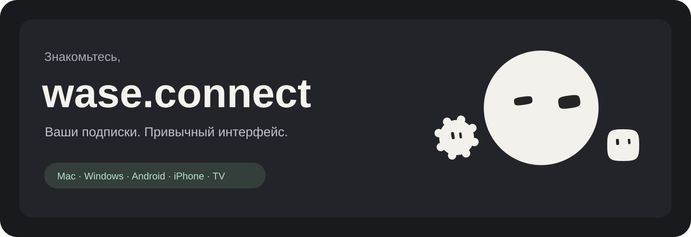

# Wase Connect

Один интерфейс для ваших VPN-подписок: серверы, избранное, маршрутизация и темы оформления.

[Статус выпуска](release-status.json) · [Что изменилось](CHANGELOG.md) · [Загрузки](https://github.com/vlad1337vlad1337-droid/wase-connect-downloads/releases) · [Совместимость](docs/COMPATIBILITY.md) · [Установка](docs/INSTALL.md) · [Для провайдеров](docs/PROVIDER-INTEGRATION.md) · [Темы и фон](docs/THEMES.md) · [Zapret для Windows](docs/ZAPRET-WINDOWS.md) · [Сообщить о проблеме](https://github.com/vlad1337vlad1337-droid/wase-connect-downloads/issues/new/choose) · [Wase Secure](https://waseworm.ru/sec)

## Загрузки

**Публичный стабильный выпуск готовится.** В этом разделе появятся установщики после проверки подписи и установки на целевых устройствах. Руководства могут описывать готовящееся обновление; это не объявление его публикации.

| Устройство | Формат | Доступность |
|---|---|---|
| Mac · Apple Silicon / Intel | Universal DMG | Внутренний пакет; подпись Apple, notarization и приёмка скачанного выпуска впереди |
| Windows x64 | EXE | UI под Wine; lifecycle WinDivert проверен на Windows Server 2022; реальная сеть и установочная приёмка впереди |
| Android | APK | Сборки ARM64 / ARMv7; физические устройства впереди |
| Android TV / Google TV | APK | Реальный телевизор, пульт и VPN ещё не прошли приёмку |
| iPhone / iPad | App Store / TestFlight | Есть неподписанные сборки симулятора и ARM64 device; подпись и устройства впереди |
| Apple TV | App Store / TestFlight | Принятого артефакта общего клиента нет |

Когда выпуск будет доступен, выбирайте установщик в **[Releases](https://github.com/vlad1337vlad1337-droid/wase-connect-downloads/releases)** под свою платформу. Автоматические архивы GitHub `Source code (zip / tar.gz)` содержат документацию этой страницы и **не устанавливают приложение**.

Сейчас готовится внутреннее обновление **2.1.16**: [проверка версии приложения](docs/APP-UPDATES.md), сохранность локальных данных и восстановление после потери системного прокси. Локальные результаты перечислены в [журнале изменений](CHANGELOG.md). Внутренние DMG, EXE и APK собраны и проверены в доступных локальных средах; неподписанная iOS ARM64 прошла компиляцию. Подпись, лицензии и приёмка на целевых устройствах остаются условиями публичного выпуска. Установщики здесь ещё не опубликованы.

## В приложении

- Подписки из разных источников, отдельные группы серверов и избранное.
- Общий интерфейс, анимированные маскоты и светлая/тёмная тема с цветными акцентами.
- [Темы v4](docs/THEMES.md) с библиотекой фонов, копированием конфигурации и прозрачностью кнопок, карточек и всплывающих окон; уменьшение прозрачности на устройстве имеет приоритет.
- Автоматический выбор сервера и ручной выбор локации.
- Базовые действия на главном экране, дополнительные параметры — в профессиональных настройках.

Возможности отдельных платформ и форматов отличаются. [Матрица совместимости](docs/COMPATIBILITY.md) описывает текущие границы.

Внутренняя версия 2.1.8 включает [экспериментальный профиль WASE + REALITY](docs/WASE-REALITY.md): отдельный HTTPS CONNECT-шлюз перед REALITY сервером, с явным подтверждением пользователя. Это требует поддержки провайдера и пока не является публичным стабильным выпуском или гарантией работы в любой сети.

## Проверка загрузки

К каждому опубликованному выпуску прилагаются версия, изменения и `SHA256SUMS.txt`. macOS-выпуски должны проходить Developer ID/notarization и проверку установки скачанного DMG. Список проверок помогает проверить конкретный файл; он не является обещанием отсутствия любых ошибок или работы в любой сети.

## Обратная связь

[Создать обращение](https://github.com/vlad1337vlad1337-droid/wase-connect-downloads/issues/new/choose). Укажите версию приложения, систему, модель устройства и шаги воспроизведения. Не публикуйте ссылки подписок, UUID серверов, пароли или личные журналы.

Предложения по интерфейсу и документации: [правила участия](CONTRIBUTING.md).

Этот репозиторий содержит страницу загрузок, документацию, оформление и проверки публикации. Исходники клиента хранятся отдельно в приватном репозитории. [Компоненты и лицензии](THIRD-PARTY-NOTICES.md).
